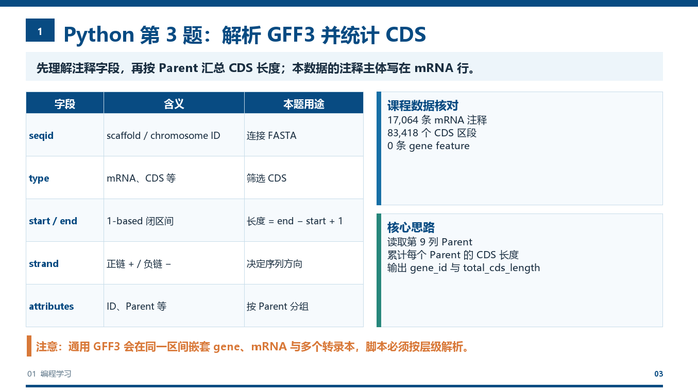
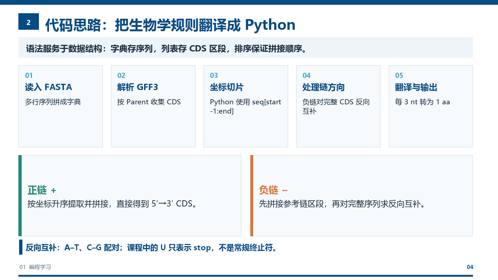
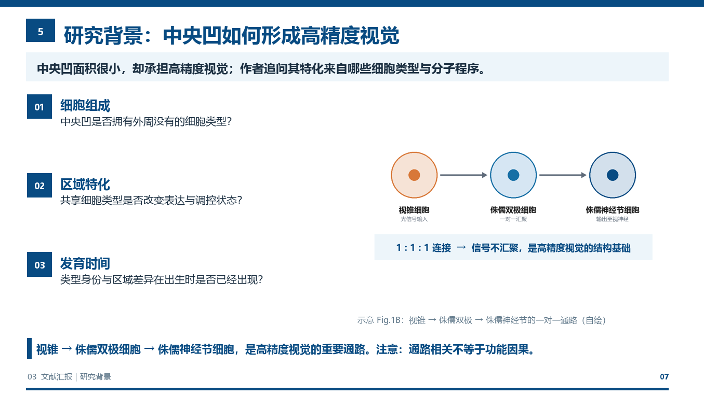

# skills

自建 AI Agent 技能合集。每个子目录是一个独立技能，`SKILL.md` 是入口文件。

| 技能 | 做什么 | 
|---|---|
| [group-meeting-ppt](group-meeting-ppt/) | 按固定的学术组会版式，把每周学习与文献内容生成汇报 PPT 和逐页讲稿。样式由脚本确定性渲染，每周产出完全一致 |
| [model-selection-six-questions](model-selection-six-questions/) | 用「模型选型六问」（目标 / 样本 / 模态 / 数据量 / 先验 / 答案形状）把科学问题定义清楚，产出可审计的建模需求说明书 |

## 预览

`group-meeting-ppt` 生成的页面：



| 流程步骤 | 文献图 + 三项解读 |
|---|---|
|  |  |

## 安装

仓库根目录提供 `install.ps1`，把技能同步到 WorkBuddy 的用户级技能目录（Windows PowerShell）：

```powershell
git clone https://github.com/Kiki-trouvaille/My-skills.git
cd My-skills
powershell -ExecutionPolicy Bypass -File .\install.ps1
```

只装其中一个：

```powershell
.\install.ps1 -Skill group-meeting-ppt
```

脚本用 `robocopy /MIR` 镜像同步，会删掉目标目录里源目录没有的文件。**仓库是唯一事实来源**，
不要在 `~/.workbuddy/skills/` 里直接改，否则下次同步会被覆盖。

也可以不用脚本，手动把某个子目录整个复制进 `~/.workbuddy/skills/`。

## 目录结构

```
skills/
├── group-meeting-ppt/            组会汇报 PPT + 讲稿
│   ├── SKILL.md
│   ├── references/               设计规范、内容规则、讲稿框架、字段说明
│   ├── scripts/                  渲染、讲稿生成、交付前自检、离屏预览
│   └── examples/                 完整样例（json / pptx / docx / 自绘示意图）
├── model-selection-six-questions/
│   ├── SKILL.md
│   ├── assets/
│   └── references/
├── docs/                         页面预览图，仅供 README 引用，不参与安装
├── install.ps1
└── LICENSE
```

## 新增技能

在根目录新建文件夹，放入 `SKILL.md`（YAML frontmatter 至少要有 `name` 和 `description`），
需要时加 `scripts/`、`references/`、`assets/`。写完后跑一次 `install.ps1` 即可生效。

## 许可

MIT，见 [LICENSE](LICENSE)。
