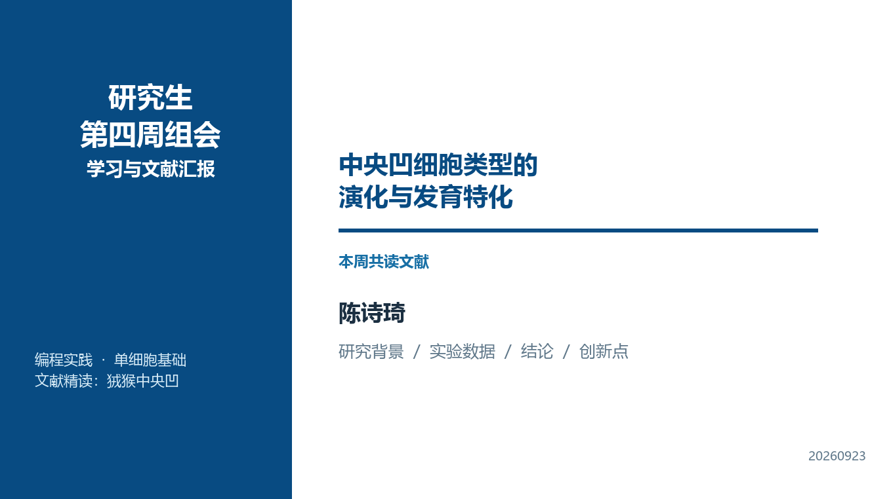
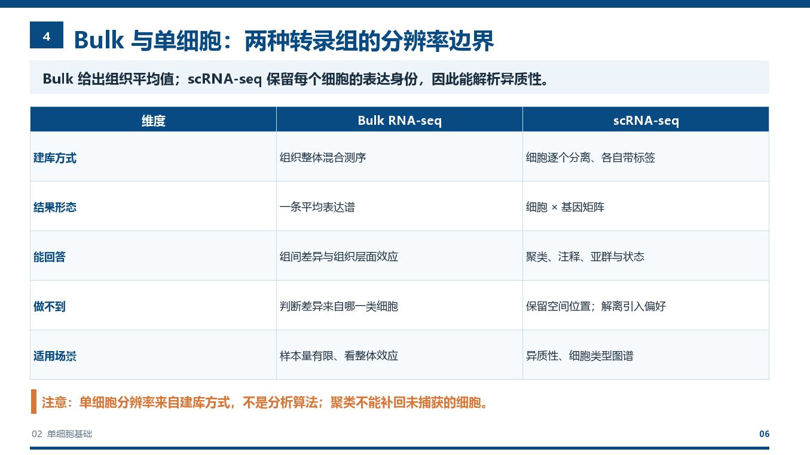
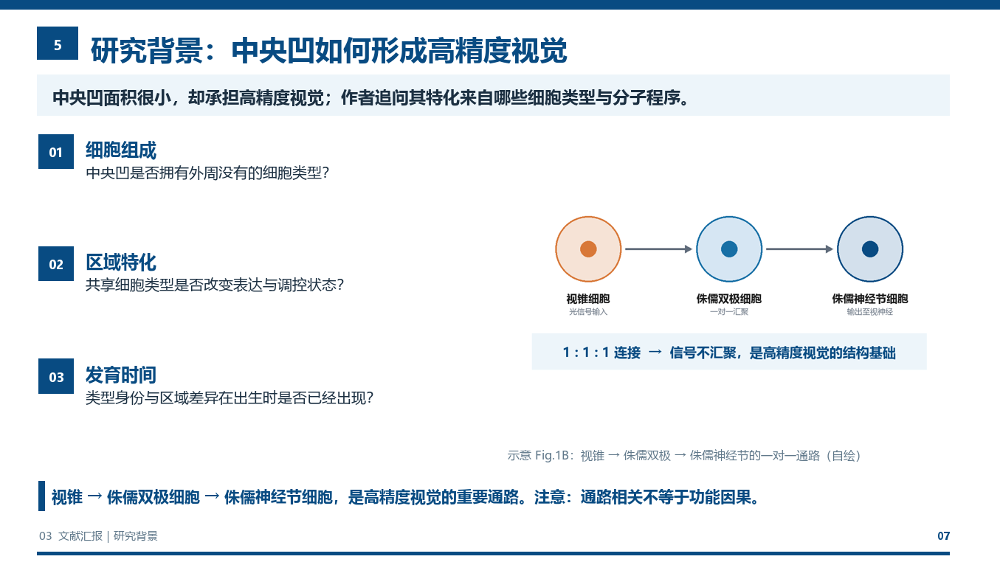
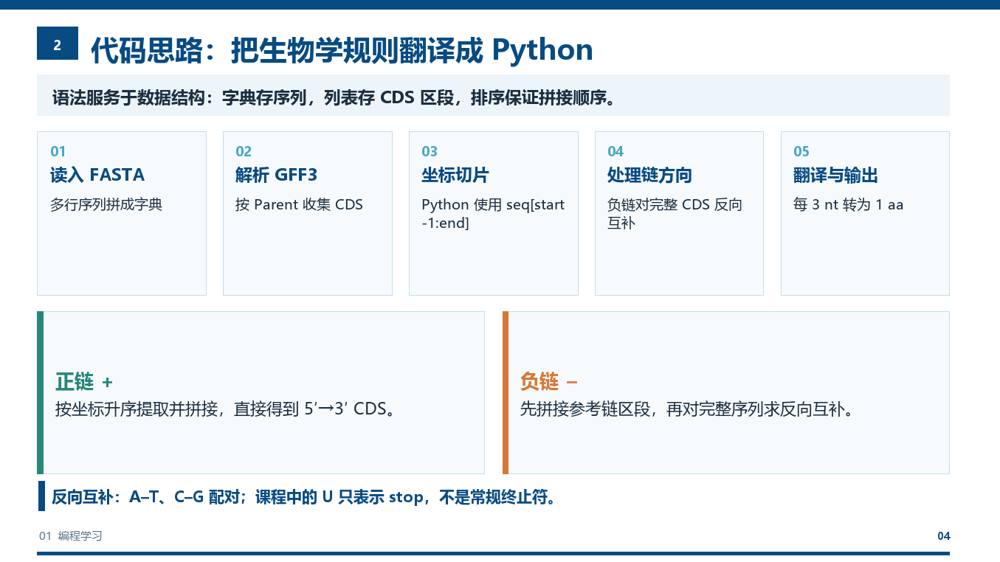

# group-meeting-ppt · 组会汇报 PPT 固定版式生成器

把每周的学习与文献内容，变成一套**版式恒定**的组会汇报 PPT 和逐页讲稿。

样式不由模型即兴发挥——所有几何、字号、配色都写死在 `scripts/build_deck.py` 的设计令牌里，
每周只换内容，产出的版式完全一致。

| 封面 | 对比表格 |
|---|---|
|  |  |

| 文献图 + 三项解读 | 流程步骤 |
|---|---|
|  |  |

## 它约束了什么

这套模板不只是好看，它把一套汇报方法论变成了可执行的规则：

- **标题公式化**。「1 Python 第3题：解析GFF3并统计CDS」——必须写清做了什么、得到什么，
  禁止「方法介绍」「结果展示」这类空标题。
- **每页总—分—总**。标题 + 导语（一句话核心事实）+ 主体 + 底部结论句，缺一不可。
- **对比一律用表格**，流程一律用序号箭头，模块切换一律用 Part 过渡页。
- **每页必须带边界**。「结论边界：…」「注意：…」「适用条件：…」——这条是硬校验，不过就报错。
- **讲稿四步**：Why 动机 / How 做法 / Read 图表精读 / So What 结论与边界，缺段报错。

## 安装

作为 WorkBuddy / Claude Code 的用户级技能：

```bash
# 只取这一个技能（稀疏检出）
git clone --filter=blob:none --sparse https://github.com/Kiki-trouvaille/My-skills.git
cd My-skills && git sparse-checkout set group-meeting-ppt
cp -r group-meeting-ppt ~/.workbuddy/skills/group-meeting-ppt
```

也可以直接下载 ZIP，把 `group-meeting-ppt` 整个文件夹放进 `~/.workbuddy/skills/`（该文件夹下就是 `SKILL.md`）。

依赖：

```bash
pip install python-pptx python-docx pillow
```

## 用法

**1. 写内容**：照 `references/schema.md` 的字段写一份 `deck.json`。
最小可用样例见 `examples/第四周_示例.json`（10 页，含全部版式）。

```json
{
  "week": "第十周", "author": "陈诗琦",
  "cover": {"title": "从空间坐标到细胞邻域\n组织结构与边界", "date_text": "20261120"},
  "slides": [
    {
      "type": "table", "no": "1", "section": "01 方法",
      "title": "两条流程对比：多出三道空间关口",
      "lead": "空间数据在单细胞流程之上增加坐标、配准、分割三道关口。",
      "head": ["阶段", "scRNA-seq", "Stereo-seq"],
      "rows": [["实验输入", "细胞悬液", "切片 + 芯片 + 图像"]],
      "note": "结论边界：空间分辨率取决于芯片与分割，不等于单细胞分辨率。",
      "note_kind": "warning"
    }
  ]
}
```

**2. 渲染**：

```bash
python scripts/build_deck.py deck.json -o 陈诗琦_第十周.pptx    # 出 PPT，同时写演讲者备注
python scripts/build_script.py deck.json -o 汇报讲稿.docx       # 出讲稿 docx + md
```

`build_deck.py` 会先跑内容自检。`-` 开头是**错误**（阻断），`·` 开头是**提醒**。
有错误必须先改 JSON。

**3. 交付前自检**：

```bash
python scripts/check.py 陈诗琦_第十周.pptx        # 包结构 / 画布 / 备注 / 字体 / 溢出估算
python scripts/preview.py 陈诗琦_第十周.pptx -o preview/   # 出 PNG，逐张目视
```

`check.py` 还会自动调用本机已装的 `pptx`、`ppt-master` 技能做外部复检，没装就跳过。

## 版式

| type | 用途 | 关键字段 |
|---|---|---|
| `cover` | 封面（左侧深蓝竖块） | `cover.title/meta_label/topics` |
| `part` | 模块过渡（Part 1 / 2） | `part/title/module` |
| `toc` | 目录（≤ 6 条） | `items[{no,title,desc}]` |
| `points` | 01/02/03 竖排，可配右图 | `items` + `figure` |
| `cards` | 2–4 张卡片并列 | `items[{no,title,body}]` |
| `table` | 对比表，可带右侧解读卡 | `head/rows/col_widths/side` |
| `flow` | 横向步骤，可带下方双栏 | `steps` + `panels` |
| `figure` | 大图 + 右侧解读 | `image/caption/side` |
| `stats` | 大数字 + 说明块 | `items[{value,label}]` + `blocks` |
| `closing` | 结束页 | `message` |

几何与配色（完整见 `references/design.md`）：

```
画布      33.87 × 19.05 cm（16:9），左边距 1.27，内容宽 30.9
主标题    微软雅黑 27pt 加粗  #084B82
导语      16.5pt  #2E4A5F，浅蓝底带 #EDF5FA
正文      15.75pt  #1A1A1A      卡片标题 18.75pt
图注      11.25pt  灰
配色      深蓝 #084B82 / 次级蓝 #176FA5 / 青绿 #27877B / 橙 #D87838（仅用于注意与局限）
```

## 目录

```
SKILL.md                 技能定义与执行流程
references/design.md     画布、网格、配色、字号、各版式线框
references/content.md    标题公式、总分总、措辞替换表
references/speech.md     四步讲稿框架、范例、时长控制
references/schema.md     deck.json 全字段说明
scripts/build_deck.py    渲染 pptx + 写入演讲者备注 + 内容自检
scripts/build_script.py  渲染讲稿 docx / md
scripts/check.py         交付前机器自检
scripts/preview.py       离屏渲染 PNG，供目视检查
examples/                完整样例（json / pptx / 讲稿 / 自绘示意图）
```

页面预览图放在仓库根目录的 `docs/` 下，不随技能安装，避免拖慢加载。

## 已知限制

- `preview.py` 是离屏近似渲染（同一套字体度量，抗锯齿与真机略有差异），定稿前建议在
  PowerPoint 里翻一遍。
- 微软雅黑不是 Office 通用字体，换到未安装的机器会回退成宋体，版式仍成立但字形变化。
- 文献图不会被生成，脚本只负责按比例缩放居中并加图注；缺图时改用 `points` / `cards`。
- `examples/fig/pathway_demo.png` 是自绘示意图，不含任何论文原始插图，可自由使用。

## 许可

MIT，见 [LICENSE](LICENSE)。
